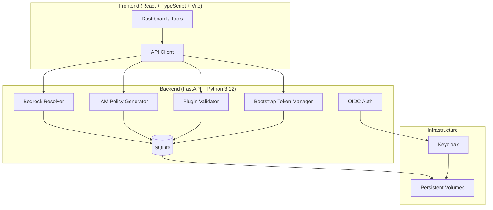

# Nexus Studio — Alan Vo

> Work in progress. This checkpoint may be incomplete or fail tests. See PLAN.md and STATUS.md before use.


**Nexus Studio | Alan Vo | AI & Machine Learning**

AI/ML developer tools for AWS Bedrock model resolution, plugin validation, and bootstrap token management.

## Problem

Working with AWS Bedrock across multiple regions requires understanding region-specific model identifier formats. The Anthropic Office add-in fails in AU regions (`ap-southeast-2`, `ap-southeast-4`) because it sends US-shaped model identifiers (`us.anthropic.*`) that don't resolve in Sydney/Melbourne endpoints, which only support `au.anthropic.*` cross-region inference profiles.

Additionally, plugin developers face schema validation errors from malformed `hooks.json` (bare `[]` instead of `{"hooks": {}}`) and syntax errors in `.mcp.json` connector configurations. The Office add-in also sends expired Entra tokens to bootstrap endpoints, causing 401 errors after ~1 hour.

## Solution

Nexus Studio provides a deterministic offline core engine that:

1. **Resolves Bedrock model identifiers** - Maps AWS regions to correct inference profile prefixes (`us`, `eu`, `au`, `apac`) and validates model IDs against region capabilities
2. **Generates IAM policies** - Creates region-aware policies with correct geographic prefixes for foundation models and inference profiles
3. **Validates plugin configurations** - Detects and fixes `hooks.json` schema violations and `.mcp.json` syntax errors
4. **Manages bootstrap tokens** - Implements MSAL `acquireTokenSilent()` flow to prevent expired token errors

All core algorithms work offline without any LLM API key.

## Architecture



## Features

### Bedrock Model Resolver
- Resolves correct inference profile ID for any AWS region
- Supports `us`, `eu`, `au`, `apac` geographic prefixes
- Validates against known Bedrock region capabilities
- Handles AU regions (inference profile only) vs US/EU/APAC (both on-demand and inference profile)

### IAM Policy Generator
- Generates policies with region-aware resource ARNs
- Includes foundation model, inference profile, and cross-region permissions
- STS AssumeRole support for cross-account access
- JSON output ready for wizard integration

### Plugin Validator
- Validates `hooks.json` against expected schema (`{"hooks": {}}`)
- Detects bare array `[]` bug affecting 4+ financial services plugins
- Validates `.mcp.json` syntax (missing commas, unclosed braces)
- Fixes invalid files automatically
- CLI and API interfaces

### Bootstrap Token Manager
- Implements correct MSAL flow: `acquireTokenSilent()` → fallback to interactive
- Prevents 401 errors from expired Entra tokens
- Returns `bootstrap_expires_at` for client-side expiry tracking
- Mock MSAL client for testing

## Quick Start

### Prerequisites
- Python 3.12+
- Node.js 24+
- Docker (optional)

### Local Development

```bash
# Backend
cd backend
python3 -m venv .venv
source .venv/bin/activate
pip install -r requirements.txt
cp ../.env.example .env
# Edit .env with your settings
python -m uvicorn app.main:app --reload --host 0.0.0.0 --port 8000

# Frontend (new terminal)
cd frontend
npm install
npm run dev

# Access at http://localhost:5173
```

### Docker Compose

```bash
# Copy and configure environment
cp .env.example .env
# Edit .env with secure secrets

# Start all services
docker-compose up -d

# Access at http://localhost:5173
# Keycloak admin at http://localhost:8080 (admin/admin123)
# Backend API at http://localhost:8000
```

## API Endpoints

| Method | Endpoint | Description |
|--------|----------|-------------|
| GET | `/api/v1/health` | Health check |
| POST | `/api/v1/bedrock/resolve` | Resolve Bedrock model identifier |
| POST | `/api/v1/bedrock/iam-policy` | Generate IAM policy |
| POST | `/api/v1/plugins/validate` | Validate plugin configs |
| POST | `/api/v1/plugins/fix` | Fix invalid plugin configs |
| POST | `/api/v1/bootstrap/token` | Get bootstrap token with refresh |

## Testing

```bash
# Backend tests
cd backend
source .venv/bin/activate
PYTHONPATH=backend python -m pytest app/tests -v

# Frontend tests
cd frontend
npm test
```

## AI/ML Evaluation

The core domain engine (Bedrock resolver) is a deterministic algorithm with no ML components. It implements AWS Bedrock's documented region-to-prefix mapping:

| Region | Prefix | Inference Types |
|--------|--------|-----------------|
| us-east-1, us-west-2 | us | ON_DEMAND, INFERENCE_PROFILE |
| eu-west-1, eu-central-1 | eu | ON_DEMAND, INFERENCE_PROFILE |
| ap-southeast-2, ap-southeast-4 | au | INFERENCE_PROFILE only |
| ap-northeast-1, ap-south-1 | apac | ON_DEMAND, INFERENCE_PROFILE |

**Reproducible validation:**
```bash
# Test AU region resolution
curl -X POST http://localhost:8000/api/v1/bedrock/resolve \
  -H "Content-Type: application/json" \
  -d '{"region": "ap-southeast-2", "foundation_model_id": "anthropic.claude-3-sonnet-20240229-v1:0"}'

# Expected: {"inference_profile_id": "au.anthropic.claude-3-sonnet-20240229-v1:0", ...}
```

**Failure cases:**
- Unknown regions default to `us` prefix with warning
- Unknown foundation models return `is_valid: false`
- AU regions never return `ON_DEMAND` in supported types

## Configuration

### Environment Variables

| Variable | Description | Default |
|----------|-------------|---------|
| `DATABASE_URL` | SQLite connection string | `sqlite+aiosqlite:///./nexus_studio.db` |
| `KEYCLOAK_URL` | Keycloak server URL | `http://localhost:8080` |
| `KEYCLOAK_REALM` | Keycloak realm | `nexus-studio` |
| `KEYCLOAK_CLIENT_ID` | OIDC client ID | `nexus-studio-client` |
| `KEYCLOAK_CLIENT_SECRET` | OIDC client secret | *(required)* |
| `LLM_PROVIDER` | LLM provider type | `openai-compatible` |
| `LLM_MODEL` | LLM model name | `gpt-4o-mini` |
| `LLM_API_KEY` | LLM API key | *(optional)* |
| `SECRET_KEY` | Session signing secret | *(required)* |
| `CSRF_SECRET` | CSRF token secret | *(required)* |

### LLM Providers

| Provider | Base URL | Models |
|----------|----------|--------|
| OpenAI-compatible | `https://api.openai.com/v1` | gpt-4o, gpt-4o-mini, etc. |
| Anthropic | `https://api.anthropic.com` | claude-3-5-sonnet, etc. |
| Gemini | `https://generativelanguage.googleapis.com` | gemini-1.5-pro, etc. |
| Ollama | `http://localhost:11434/v1` | llama3, mistral, etc. |
| OpenRouter | `https://openrouter.ai/api/v1` | Various |

## SSO/SAML Setup

Keycloak supports upstream SAML IdPs through identity brokering:

1. In Keycloak Admin Console → Identity Providers → Add SAML v2.0
2. Configure IdP metadata (entity ID, SSO URL, certificates)
3. Map SAML attributes to Keycloak user attributes
4. Enable "First Login Flow" for user provisioning
5. Update `nexus-studio-client` to use the brokered identity provider

## Security Limitations

- SQLite is used for development; production should use PostgreSQL
- Demo users (admin/analyst/viewer) have default passwords - change in production
- Keycloak dev mode (`start-dev`) is not for production use
- TLS termination should be handled by reverse proxy (nginx/Traefik)
- LLM API keys are server-side only, never exposed to frontend

## Backup & Restore

```bash
# Backup SQLite database
cp backend/data/nexus_studio.db backup/nexus_studio_$(date +%Y%m%d).db

# Backup Keycloak
docker exec nexus-studio-keycloak \
  /opt/keycloak/bin/kc.sh export --dir /opt/keycloak/data/backup --realm nexus-studio
```

## License

MIT License - Copyright (c) 2024 Alan Vo <alanvo@gmail.com>